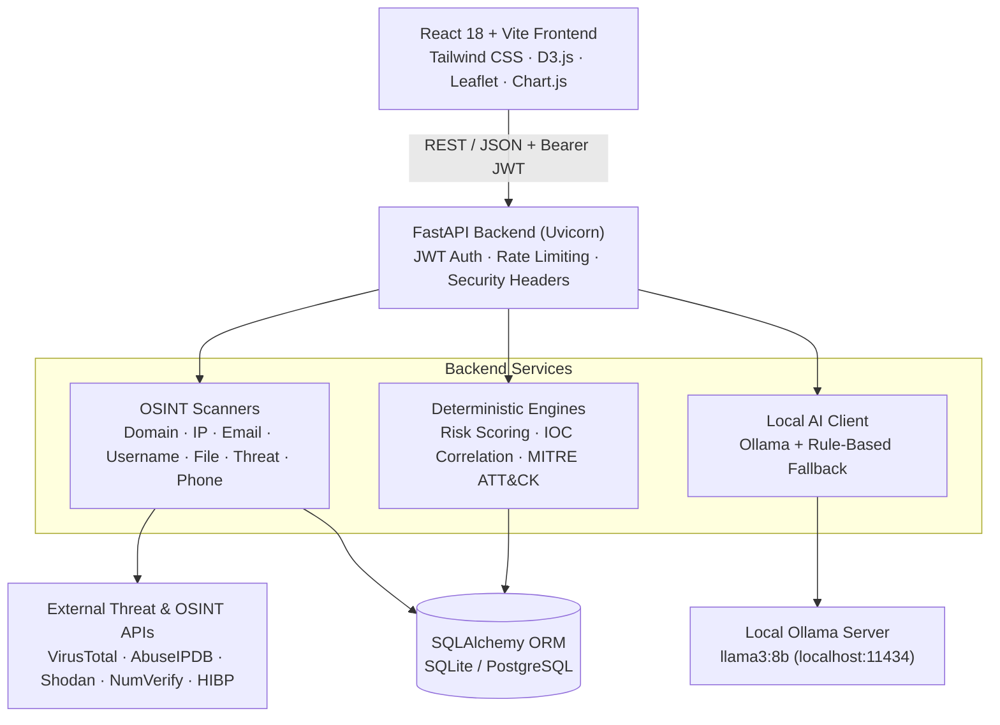
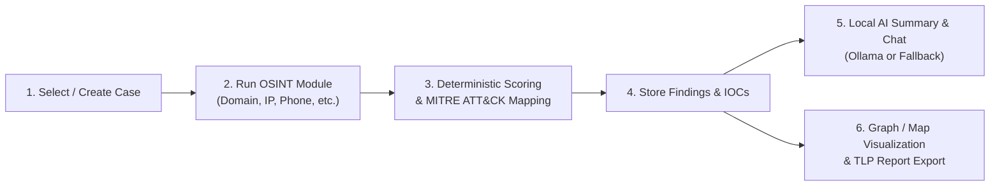

# OSINT-X

**OSINT-X** is a full-stack, case-driven **Open-Source Intelligence (OSINT) & Threat Analysis Platform** that unifies 7 intelligence modules, interactive visualizations, TLP-classified reporting, security audit logging, and a **100% local AI assistant (Ollama)** inside a single analyst workspace.

> **Privacy-First by Design:** AI analysis runs locally via **Ollama (`llama3:8b`)** with automatic rule-based fallback—zero external LLM API keys and zero case data sent to third-party cloud LLMs.

---

## Key Features

- **7 Integrated OSINT Modules**
  - **Domain Intelligence:** WHOIS/RDAP, DNS records (`A`, `MX`, `NS`, `TXT`), SSL/TLS certificate inspection, HTTP security header grading (`A+`–`F`), tech stack detection, and subdomain enumeration.
  - **IP Intelligence:** Geolocation, ASN/ISP, reverse DNS, and **consent-gated port scanning**.
  - **Email Intelligence:** Syntax/domain validation, MX/SPF/DMARC checks, and breach lookup support (HIBP).
  - **Username Intelligence:** Cross-platform account/profile enumeration.
  - **File Forensics:** Cryptographic hashing, EXIF/image metadata extraction (`Pillow`), and artifact analysis.
  - **Threat Intelligence:** Multi-feed reputation scoring across **VirusTotal**, **AbuseIPDB**, and **Shodan** with deterministic simulation fallback when offline or unconfigured.
  - **Phone Intelligence:** Number validation, carrier lookup, line type (`mobile`, `landline`, etc.), country/prefix, and region lookup via **NumVerify** (with simulation fallback).
- **Local AI Engine & Chatbot**
  - Powered by **Ollama (`llama3:8b`)** with an automatic **rule-based fallback engine** when Ollama is offline.
  - Executive case summaries, risk score explanations, cross-case IOC correlation, deterministic **MITRE ATT&CK** technique mapping, and natural-language search.
- **Interactive Visualizations:** D3.js entity relationship graph, Leaflet geolocation map, Chart.js metrics, and investigation timeline view.
- **Security & Governance:** JWT authentication (`HS256`), `bcrypt` password hashing, RBAC (`admin` / `analyst`), `slowapi` rate limiting, `SecurityHeadersMiddleware`, explicit consent logging for active scans, and enterprise audit trails.

---

## System Architecture



---

## Tech Stack

| Layer | Technologies |
|---|---|
| **Frontend** | React 18, Vite 5, Tailwind CSS 3, React Router v6, TanStack React Query, Axios, D3.js, Leaflet / React-Leaflet, Chart.js |
| **Backend** | Python 3.12, FastAPI 0.115, Uvicorn, Pydantic v2, `slowapi`, `httpx`, `dnspython`, `Pillow` |
| **Database & Migrations** | SQLAlchemy 2.0, Alembic, SQLite (local dev) / PostgreSQL (`psycopg2-binary`) |
| **Auth & Security** | `python-jose` (JWT), `bcrypt`, `SecurityHeadersMiddleware`, Consent Gate |
| **Local AI** | Ollama REST API (`llama3:8b`) + built-in fallback engine |

---

## Investigation & AI Analysis Flow



---

## Project Structure

```text
OSINT-X/
├── backend/
│   ├── api/                 # FastAPI routers (auth, investigations, domain, ip, email, username, file_intel, threat_intel, phone_intel, ai_engine, visualization, reports, audit, health)
│   ├── core/                # Config, security (JWT/bcrypt), rate limiting, validation, consent, logging
│   ├── database/            # SQLAlchemy engine & session management
│   ├── middleware/          # Security headers middleware
│   ├── models/              # ORM models (User, Investigation, Finding, IOC, Report, AuditLog, ConsentLog)
│   ├── schemas/             # Pydantic schemas
│   ├── services/            # OSINT scanners, risk engine, MITRE mapper, correlation, Ollama client
│   ├── tests/               # Pytest suite (phases 1–12 & report system)
│   ├── alembic/             # Database migrations
│   ├── main.py              # FastAPI entrypoint
│   └── requirements.txt
├── frontend/
│   ├── src/
│   │   ├── components/      # Scanner modules (Domain, IP, Email, Username, File, Threat, Phone) & D3/Leaflet/Chart visualizations
│   │   ├── contexts/        # AuthContext
│   │   ├── layouts/         # MainLayout
│   │   ├── pages/           # Dashboard, AiAssistantPage, VisualizationPage, ReportsPage, AuditLogsPage, Login, Register, Landing
│   │   ├── routes/          # Protected & public routes
│   │   └── services/        # Axios API clients
│   └── package.json
├── docker-compose.yml
└── .env.example
```

---

## Quick Start (Local Development)

### 1. Configure Environment Variables

Copy `.env.example` to `.env` (and `backend/.env` if running from `backend/`):

```powershell
copy .env.example .env
```

Optional free-tier API keys (modules run in deterministic simulation mode when left blank):
- `VIRUSTOTAL_API_KEY`
- `ABUSEIPDB_API_KEY`
- `SHODAN_API_KEY`
- `NUMVERIFY_API_KEY`
- `HIBP_API_KEY`

### 2. Start Local AI Chatbot (Optional — Ollama)

If Ollama is not running, the AI Assistant automatically uses its built-in rule-based fallback engine.

```powershell
ollama pull llama3:8b
ollama serve
```

### 3. Start the Backend (FastAPI)

Run from inside the `backend/` directory so it loads `backend/.env` and `backend/osintx.db`:

```powershell
cd backend
pip install -r requirements.txt
python -m uvicorn main:app --reload --host 127.0.0.1 --port 8000
```

- API Base URL: `http://127.0.0.1:8000`
- Interactive Swagger Docs: `http://127.0.0.1:8000/docs`

### 4. Start the Frontend (React + Vite)

```powershell
cd frontend
npm install
npm run dev
```

- Web App: `http://localhost:5173`

---

## Running Tests

```powershell
pytest backend/tests -o pythonpath=backend
```

---

## Future Scope

- **Async Scan Workers:** Offload bulk/long-running scans to Celery + Redis with WebSocket progress streaming.
- **Phone OSINT Persistence & Enrichment:** Persist phone lookup findings/IOCs to cases and integrate VoIP/disposable-number risk feeds.
- **STIX/TAXII & SIEM Export:** Export indicators in STIX 2.1 format and integrate webhooks for Splunk, Wazuh, and Elastic SIEM.
- **RAG over Historical Cases:** Index past investigation reports into a local vector store alongside Ollama for cross-case semantic search.
